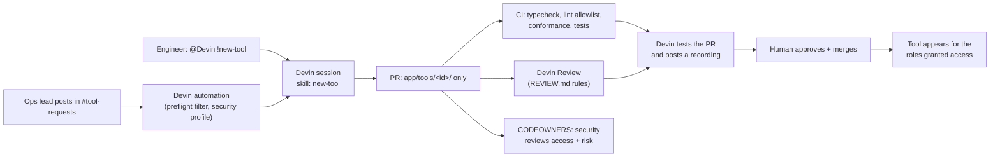
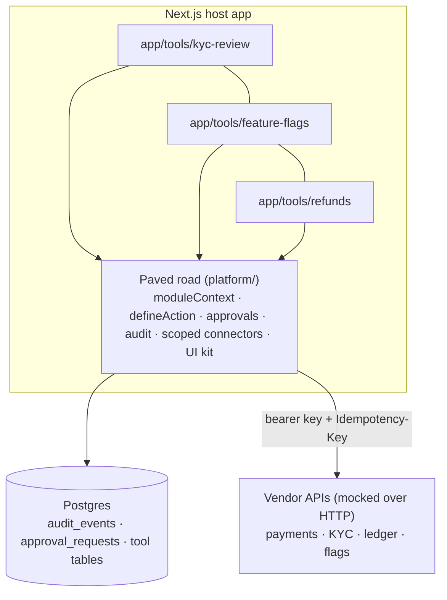

# Toolyard

**A thin, owned paved road for internal tools. Devin builds the tools and keeps them running.**

- **Demo video:** _link added after recording_.

## The idea in three bullets

- **The builder is becoming a commodity; the guardrails are what's worth paying for.** Microsoft now hosts React "code apps" on Power Platform and recommends AI coding agents for building them. What a platform still uniquely sells is the managed host: identity, connectors that keep credentials server-side, data-loss policies, approvals, audit, and environments.
- **Toolyard keeps those guardrails as a small layer of code you own.** It covers SSO-shaped auth and roles, audited actions, maker-checker approvals, idempotent vendor connectors limited to declared scopes, and CI checks that every tool stays on the paved road.
- **Devin is the builder and the maintainer.** People request tools in plain English in Slack. Devin builds each one as a single folder, opens a PR, and tests it. Devin Review, CI, and code owners gate the merge. Automations handle dependency updates, CI fixes, and security scans. **Anyone can build. Engineers approve.**

## Quickstart

Prerequisites: Node 22+ (24 recommended) and Docker.

```bash
cp .env.example .env
docker compose up -d db      # Postgres 17 on localhost:5433
npm install
npm run setup                # schema + deterministic seed (payments, KYC cases, ledger, flags)
npm run dev                  # http://localhost:3000, then pick a persona
```

| Command | What it does |
|---|---|
| `npm run check` | registry + typecheck + lint + tests (tests use a separate `toolyard_test` DB) |
| `npm run build` | production build |
| `npm run db:reset` | reset and reseed the dev DB |
| `npm run tool:new -- <id> "<Name>"` | scaffold a new tool from `templates/tool/` |

### Personas (mock SSO)

| Persona | Roles | Try |
|---|---|---|
| Alex Rivera | support_agent | Refunds: small refunds run immediately, large ones need approval |
| Priya Shah | ops_lead | Approve refunds; your own requests never show up in your queue |
| Sam Lee | kyc_analyst | Work the KYC queue; high-risk approvals go to compliance |
| Morgan Diaz | compliance_officer | Reveal PII (with a reason), approve escalations, read the audit log |
| Jordan Park | engineer, oncall | Change flags in dev/staging, use the prod kill switch (reviewed afterwards) |
| Taylor Wong | engineer, eng_lead, platform_admin | Approve prod flag changes, view the admin inventory |

## How a tool gets built



## Architecture



- **Tools** are folders containing `manifest.ts`, `access.ts`, pages, `actions.ts`, and tests. Pages read through `moduleContext(manifest)`; writes go through `defineAction(manifest, …)`. The full contract is in [`AGENTS.md`](AGENTS.md).
- **`defineAction` lifecycle:**
  1. Session check, then permission check. Denials are audited.
  2. Zod validation.
  3. Idempotency key.
  4. Approval rule (maker-checker, or break-glass with post-hoc review).
  5. A **write-ahead `attempted` audit row, committed before any vendor call.**
  6. The handler runs.
  7. A `succeeded` / `failed` outcome row.
- **Connectors** are typed HTTP clients. A tool can only call the scopes its manifest declares, and its risk tier must match the highest of those scopes.
- **Mock vendors** behave like real APIs: bearer auth, `Idempotency-Key` replay and conflict handling, validation, a balanced double-entry ledger that dedupes on `external_id`, and atomic refunds that can't over-refund.

## Power Apps → Toolyard

| Power Platform capability | Toolyard |
|---|---|
| Canvas / model-driven builder, Copilot | Devin + repo skills + `templates/tool` |
| Dataverse | Postgres; tools own tables prefixed with their id |
| Connectors with managed credentials | `platform/connectors` (server-only, typed, bearer keys) |
| Data-loss-prevention policies | Connector scopes per tool, enforced at runtime and checked in CI; risk tier derived from scopes |
| Entra ID security roles | IdP group → role mapping; per-tool `access.ts` (security code-owns it) |
| Field-level security | KYC PII masked by default; reveal requires a reason and is audited |
| Auditing | Append-only `audit_events` (a DB trigger blocks UPDATE/DELETE), write-ahead attempts |
| Power Automate approvals | One approvals primitive: `pre` (maker-checker) and `post-hoc` (break-glass) modes, atomic claim, no self-approval |
| Environments, solutions, pipelines | Git, PRs, CI, branch protection, code owners |
| Admin center / CoE inventory | `/admin`: owners, risk tiers, scopes, who can do what |
| Vendor-managed patching | Devin automations (weekly dependency PRs, CI auto-fix) + Security Swarm |

## Guardrails and where they're enforced

| Rule | Enforced by |
|---|---|
| Reads via `moduleContext`, writes via `defineAction` | Runtime wrappers, conformance (`PAGE_WITHOUT_CONTEXT`, `ACTION_UNWRAPPED`), Devin Review |
| Tools import only `@/platform/{define,module,ui}` | ESLint allowlist + conformance (`FORBIDDEN_IMPORT`) |
| No `fetch` / `process.env` / route handlers in tools | ESLint + conformance (`ROUTE_HANDLER`) |
| Every action rejects users without its permission | Conformance (`ACTION_UNWRAPPED`) forces every action through `defineAction`, which checks the session and permission before validating input (`platform/module.test.ts`) |
| Connector scopes ⇒ risk tier | Types, a runtime proxy (`ConnectorScopeError`), conformance (`RISK_MISMATCH`) |
| Access grants reviewed by security | CODEOWNERS on `app/tools/*/access.ts` and `manifest.ts` |
| Scaffolds aren't shippable until tested | Conformance (`TESTS_TODO`, `DESCRIPTION_TODO`) |
| Exactly-once money movement | Idempotency keys end to end, ledger `external_id` = refund id, atomic approval claims (`platform/money-movement.test.ts`) |

## Devin agents

| Agent | Status | Config |
|---|---|---|
| **Tool Factory**: Slack `#tool-requests` → new tool or change request | Configured | [`devin/automations.md`](devin/automations.md), skills in [`.agents/skills`](.agents/skills) |
| **Engineer macros**: `!new-tool`, `!change-tool` | Configured | [`devin/playbooks`](devin/playbooks) |
| **Devin Review**: auto-review every PR | Configured | [`REVIEW.md`](REVIEW.md) |
| **Security Swarm**: fintech threat-model scan | Configured | [`devin/security-swarm-profile.md`](devin/security-swarm-profile.md) |
| **Weekly dependency update** + **CI auto-fix** | Configured | [`devin/automations.md`](devin/automations.md) |
| Least-privilege **security profile** for automation sessions | Configured | [`devin/security-profile.md`](devin/security-profile.md) |
| Devin Oncall, DeepWiki, Code Scans, Linear intake, Dynamic Workflows (bulk migrations) | Roadmap | n/a |

## Repo layout

```
app/                 host app: catalog, /approvals, /audit, /admin, /login, tools under app/tools/<id>/
platform/            the paved road: define, module (actions + context), approvals, audit, auth, connectors, db, ui
mock-vendors/        simulated vendor APIs served at /api/mock/<vendor>/…
templates/tool/      scaffold used by `npm run tool:new`
tests/               test setup, helpers, fixtures, paved-road conformance
.agents/skills/      Devin skills: new-tool, change-tool, test-tool
devin/               automations, playbooks, security profiles, environment blueprint, example requests
```

## What's mocked, and the limits

- **SSO is mocked:** a persona picker and an HMAC-signed cookie. The session carries OIDC-shaped claims (`sub`, `email`, `groups`), so wiring up Okta or Entra only replaces sign-in.
- **Vendors are simulated** over HTTP, with realistic semantics and deterministic seed data.
- **Schema changes use `drizzle-kit push`.** Production would use generated migrations per tool.
- **Local Docker only.** Production would run on Vercel (or similar) with managed Postgres, preview deployments, and backups.
- **An `attempted` audit row without an outcome** (a crash during a vendor call) shows up as "unresolved" on `/audit`. Retrying with the same key is safe. A reconciler job is roadmap.
